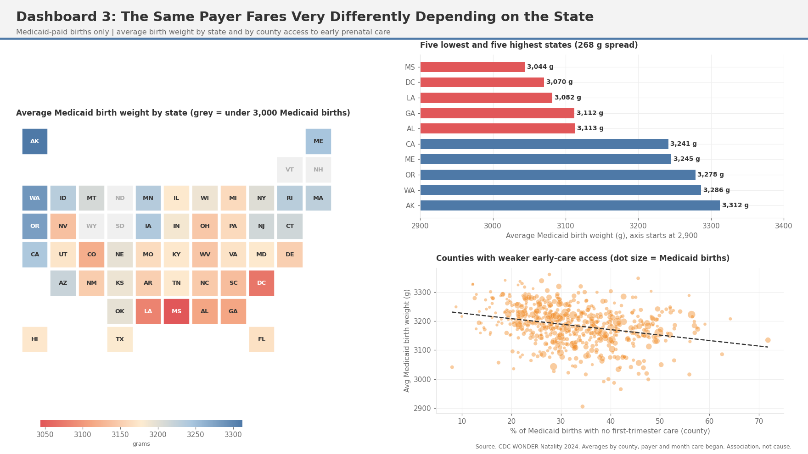
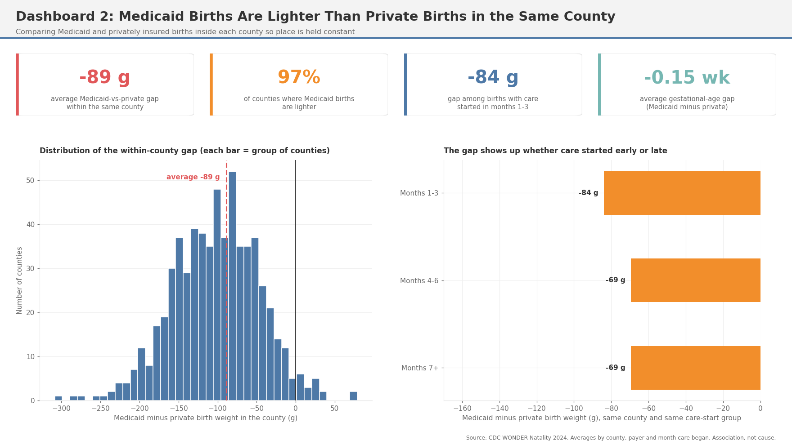

# Prenatal Care Access and Birth Outcomes Among Medicaid Mothers

Medicaid mothers are far more likely to start prenatal care late or not at all, and their babies are lighter on average. This project uses 3.6 million 2024 births (1.4 million paid by Medicaid) across 626 county units to see how much of that gap goes with care timing and how much depends on where a mother lives.

Data: CDC WONDER Natality, 2024 Tools: Python (pandas, numpy, scipy, matplotlib), SQL (SQLite), dashboards Full write-up: report.md

**Full write-up: [report.md](report.md)**

Key Findings
1. No prenatal care is the biggest risk signal
33.9% of Medicaid births had no first-trimester care, versus 14.7% for private insurance.
Births with no care are about 230 g lighter and 0.74 weeks shorter.


2. Late care does not explain the whole Medicaid gap
In the same county, Medicaid births are 89 g lighter than private births (true in 97% of counties).
Looking only at births with early care, the gap is still about 84 g.


3. Where a Medicaid mother lives matters
Average Medicaid birth weight runs from 3,044 g (Mississippi) to 3,312 g (Alaska).
Most of the county pattern is differences between states. Within a state, the early-care effect is small and not significant.
Medicaid-heavy counties stay lighter even inside the same state (43 g gap).


Unexpected Insights
Self-pay is a puzzle. Self-pay births have the highest no-care rate (44.5%) but the best birth weight and gestation averages of any payer. Nothing in the file explains it.
Rural is not worse overall. Small-county pools have slightly heavier babies (3,256 g vs 3,238 g), but the Medicaid vs private gap is wider there (about 112 g vs 87 g).
The county effect is mostly a state effect. Weak early-care counties look worse until you compare within a state, where the effect shrinks from 19 g to 7 g.
Risks stack. Counties high on both Medicaid share and missing early care average 73 g lighter births than counties in neither group.
Care timing can mislead. Late starters show longer pregnancies (39.1 weeks for month 9) because a pregnancy that ends early has less time for care to start.
Recommendations
Get Medicaid mothers into first-trimester care and reach the 3% who get none.
Set priorities by state and county. Orleans Parish LA, Fulton County GA and St. Louis County MO have the lightest Medicaid births among larger counties with weak early care.
Look beyond appointment timing, since the community effect survives comparing within states.

## Layout
```
data/raw/natality_2024.csv      CDC WONDER export
sql/                            eda.sql (exploring), county_summary.sql (builds the county table analysis.py needs)
load_data.py                    loads the CSV into SQLite
run_sql.py                      runs a .sql file
analysis.py                     main analysis, writes CSVs to output/
multivariate_model.py           Medicaid, care timing, county size model
dashboards.py                   builds the dashboard PNGs
dashboards/                     the three dashboards
tableau_setup_guide.md          how to rebuild them in Tableau
report.md                       findings
output/                         generated CSVs and charts
```

## Run it
Needs Python 3 with pandas, numpy, scipy, matplotlib. From this folder:
```
python3 load_data.py
python3 run_sql.py sql/county_summary.sql
python3 analysis.py
python3 multivariate_model.py
python3 dashboards.py
```
