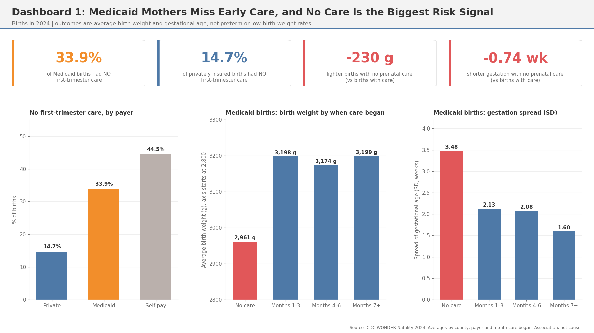

# Prenatal Care Access and Birth Outcomes Among Medicaid Mothers

An analysis of 2024 CDC WONDER birth data (3.6 million births, 1.4 million paid by Medicaid). It looks at whether Medicaid mothers get less early prenatal care, whether that goes with lighter and earlier births, and how much it depends on location.

**Full write-up: [report.md](report.md)**

Main results:
- 33.9% of Medicaid births had no first-trimester care, versus 14.7% for private insurance.
- Births with no prenatal care are about 230 g lighter and 0.74 weeks shorter.
- Medicaid births are 89 g lighter than private births in the same county, and still about 84 g lighter when care started early.
- Average Medicaid birth weight ranges from 3,044 g (Mississippi) to 3,312 g (Alaska).

The data has averages, not preterm or low-birth-weight rates, and covers one year, so these are associations only.



## Layout
```
data/raw/natality_2024.csv      CDC WONDER export
sql/                            eda.sql (exploring), county_summary.sql (builds the county table analysis.py needs)
load_data.py                    loads the CSV into SQLite
run_sql.py                      runs a .sql file
analysis.py                     main analysis, writes CSVs to output/
multivariate_model.py           Medicaid, care timing, county size model
dashboards.py                   builds the dashboard PNGs
dashboards/                     the three dashboards
tableau_setup_guide.md          how to rebuild them in Tableau
report.md                       findings
output/                         generated CSVs and charts
```

## Run it
Needs Python 3 with pandas, numpy, scipy, matplotlib. From this folder:
```
python3 load_data.py
python3 run_sql.py sql/county_summary.sql
python3 analysis.py
python3 multivariate_model.py
python3 dashboards.py
```
